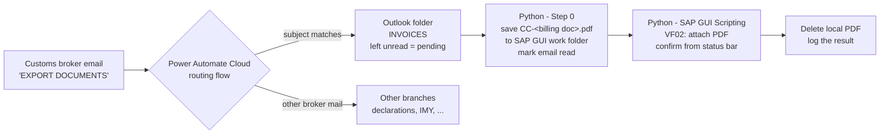
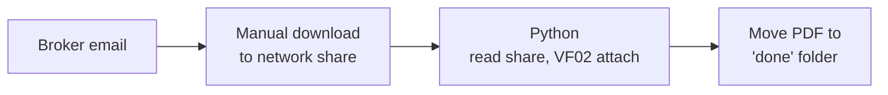

# Customs Broker Invoice Pipeline

End-to-end pipeline that takes export invoices sent by customs brokers by email and attaches them to the matching billing documents in SAP — without anyone opening a mailbox, a network folder or a SAP screen.

**Stack:** Power Automate Cloud · Outlook (COM) · Python · SAP GUI Scripting

## How it works

1. **Routing (Power Automate Cloud).** A cloud flow watches the inbox for mail from the customs brokers. Mails whose subject contains the export-documents keyword skip the main declarations path and are moved to a dedicated `INVOICES` Outlook folder, **left unread** — unread means "not processed yet".
   - Brokers mix Greek and Latin capitals in subjects (e.g. a Greek `Ι` that looks like a Latin `I`). The flow normalises the subject before comparing:
     `replace(replace(replace(toUpper(subject),'Ι','I'),'Μ','M'),'Υ','Y')` (first letter of each pair is Greek, second Latin).
2. **Step 0 (Python + Outlook COM).** Reads the unread mails of that folder, saves only attachments named `CC-<billing document>.pdf` straight into the SAP GUI work folder, skips anything already pending or already attached, and marks a mail as read only when all its attachments were saved.
3. **Attach (Python + SAP GUI Scripting).** For every pending PDF, opens the billing document in VF02 and attaches the file through the GOS menu. Each attach is confirmed from the SAP status bar before moving on.
4. **Clean-up.** The local PDF is deleted after a confirmed attach — SAP holds the document from then on.

Reliability: file logging with per-step timing, a cross-process SAP lock (only one automation drives SAP at a time) and SAP credentials from Windows Credential Manager (`keyring`).

## How it evolved

| | Before (`legacy/invoice_attach_v1.py`) | Now (`invoice_attach.py`) |
|---|---|---|
| Source of PDFs | network share, filled by hand | Outlook folder, filled by the cloud flow |
| "Pending" marker | file present in the share | email still unread |
| After attach | PDF moved to a "done" folder | PDF deleted (SAP keeps it) |
| Manual steps | download + save every attachment | none |

## Configuration

Paths are relative: the SAP GUI work folder is `~/Documents/SAP/SAP GUI`, and the "done" list lives next to the script. SAP user, connection and client are placeholders (`YOUR_SAP_USER`, `YOUR_SAP_CONNECTION`, `YOUR_CLIENT`); the password is read from Windows Credential Manager.

## License

Copyright (c) 2026 Petros Vachaviolos. All rights reserved. Proprietary; shown here as a portfolio. No use, copying or redistribution without the author's written permission. See [LICENSE.txt](LICENSE.txt).
